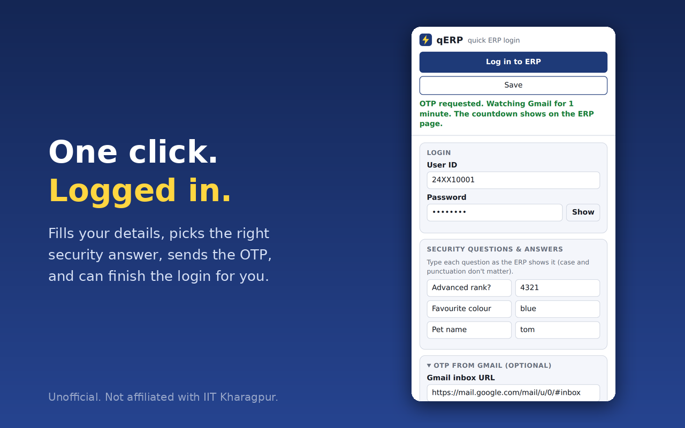
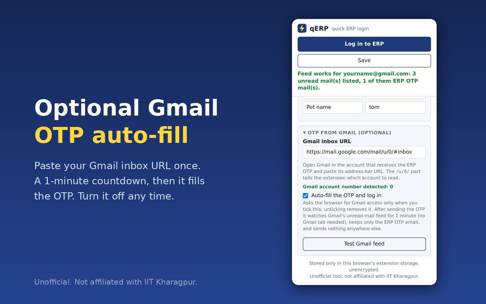

# qERP

**Quick, one-click login for the IIT Kharagpur ERP**

Fills your details, picks the right security answer, requests the OTP, and (optionally) reads the OTP from your Gmail and logs you in.

*An unofficial project. Not affiliated with, endorsed by, or sponsored by IIT Kharagpur.*

## Videos

<table>
  <tr>
    <td align="center" width="50%">
      
       <b>Firefox</b>
    </td>
    <td align="center" width="50%">
      
       <b>Chrome</b>
    </td>
  </tr>
</table>

## Contents

- [qERP](#qerp)
  - [Videos](#videos)
  - [Contents](#contents)
  - [What it does](#what-it-does)
  - [Install](#install)
    - [Which download do I need?](#which-download-do-i-need)
    - [Chrome, Edge, Brave and other Chromium browsers](#chrome-edge-brave-and-other-chromium-browsers)
    - [Firefox](#firefox)
  - [First-time setup](#first-time-setup)
  - [Optional: OTP from Gmail](#optional-otp-from-gmail)
  - [Troubleshooting](#troubleshooting)
  - [Privacy and security](#privacy-and-security)
  - [How it works](#how-it-works)
  - [Updating and uninstalling](#updating-and-uninstalling)
  - [Feedback and contributing](#feedback-and-contributing)
  - [License](#license)

## What it does

The ERP login page makes you type four things and then fetch an OTP by hand, and it blocks paste and browser autofill. qERP does the tedious part:

1. Click **Log in to ERP** in the extension.
2. It fills your User ID and password.
3. It reads the security question the ERP shows and types the matching answer. You can save all three of your questions, so it works whichever one the ERP asks.
4. It presses **Get OTP**.
5. Optional: it watches your Gmail for the OTP email, fills the OTP and clicks **Log In**. A one-minute countdown shows on the page. If the OTP doesn't turn up, it stops and you type it yourself.

If something goes wrong, it tells you right away instead of failing silently.

## Install

qERP isn't in the Chrome Web Store or Firefox Add-ons, so you install it from this page. It takes about a minute.

**Browsers:** Chrome, Edge, Brave, Opera, Vivaldi and other Chromium browsers; Firefox 140 or newer. Desktop only. Phones and Safari aren't supported.

### Which download do I need?

| Your browser                        | Download from the [latest release](../../releases/latest) | Stays installed after restart? |
| ----------------------------------- | --------------------------------------------------------- | ------------------------------ |
| Chrome, Edge, Brave, Opera, Vivaldi | `qerp-chrome-<version>.zip`                               | Yes                            |
| Firefox (recommended)               | `qerp-firefox-<version>.xpi`                              | Yes                            |
| Firefox (if there's no `.xpi`)      | `qerp-firefox-<version>.zip`                              | No, reload after each restart  |

You can also click **Code → Download ZIP** on this page. The two ready-to-use folders are `chrome/` and `firefox/`.

### Chrome, Edge, Brave and other Chromium browsers

1. Download `qerp-chrome-<version>.zip` and **unzip it into a folder you'll keep**, such as `Documents/qerp`. The browser reads the extension from that folder every time it starts, so don't move or delete it.
2. Open your browser's extensions page by pasting the address into the address bar:

   | Browser | Address                |
   | ------- | ---------------------- |
   | Chrome  | `chrome://extensions`  |
   | Edge    | `edge://extensions`    |
   | Brave   | `brave://extensions`   |
   | Opera   | `opera://extensions`   |
   | Vivaldi | `vivaldi://extensions` |

3. Turn on **Developer mode**. It's a switch at the top right in Chrome and Brave, and in the left sidebar in Edge.
4. Click **Load unpacked** and pick the folder that contains `manifest.json`. If you downloaded the whole repo, that's the `chrome` folder.
5. Pin it: click the puzzle-piece icon in the toolbar, then the pin next to **qERP**.

Developer mode is needed because the extension isn't in the Chrome Web Store. Your browser may occasionally remind you that developer-mode extensions are active. That's normal, so keep it.

### Firefox

**Option A: signed file (recommended).** This one stays installed.

1. Download `qerp-firefox-<version>.xpi` from the [latest release](../../releases/latest).
2. Open it in Firefox, either by dragging the file into a Firefox window, or via the gear icon in `about:addons` → **Install Add-on From File…**.
3. Click **Add**.
4. Open `about:addons` → **qERP** → **Permissions** and make sure access to `erp.iitkgp.ac.in` is allowed. Without it, nothing gets filled.

**Option B: temporary install.** Use this if the release has no `.xpi`. It disappears when you close Firefox, so you'll repeat it each session.

1. Download and unzip `qerp-firefox-<version>.zip` (or use the `firefox` folder from the repo).
2. Open `about:debugging#/runtime/this-firefox`.
3. Click **Load Temporary Add-on…** and select the `manifest.json` file inside the folder.
4. Check the site permission as in Option A, step 4.

**Option C: Firefox Developer Edition, Nightly or ESR.** In `about:config`, set `xpinstall.signatures.required` to `false`, then install the zip as in Option A. Regular Firefox does not allow this.

Pin the icon with the puzzle-piece button in the toolbar.

## First-time setup

1. Click the **qERP** icon.
2. Enter your **User ID** and **password**.
3. Under **Security questions & answers**, add your questions and their answers. Type each question as the ERP shows it. Capital letters and punctuation don't matter. To see your questions, go to the ERP login page, type your User ID, and the ERP shows one of them. You don't need all three now: when the ERP asks one qERP doesn't know, it adds the question for you and asks for the answer.
4. Click **Save**.
5. Click **Log in to ERP**. If you're not on the ERP login page, qERP opens it for you.

The status message at the top of the popup tells you what happened.

## Optional: OTP from Gmail

This makes qERP fill the OTP and click **Log In** for you. It only works if the ERP OTP email arrives in a Gmail account that's signed in to this same browser.

1. In that browser, open Gmail in the account that receives the ERP OTP. Copy the address from the address bar, for example `https://mail.google.com/mail/u/0/#inbox`. The number after `/u/` tells qERP which account to read.
2. In qERP, expand **OTP from Gmail (optional)** and paste the URL. It shows "Gmail account number detected".
3. Tick **Auto-fill the OTP and log in**. Your browser asks to allow access to Gmail. Allow it.
4. Press **Test Gmail feed**. It tells you which account it can see and how many ERP OTP emails are unread. Check that it's the right account.

After that, **Log in to ERP** does the whole thing: it requests the OTP, watches Gmail for up to one minute while showing a countdown, then fills the OTP and logs in.

Good to know:

- The OTP email must still be **unread**. Gmail's feed only lists unread mail, so don't open the email before qERP finds it.
- Stay signed in to Gmail in that browser. You don't need a Gmail tab open.
- If anything is wrong with Gmail, you see a red message straight away. The normal login steps still run, and you type the OTP yourself.
- Untick the option at any time. That also removes Gmail access from the extension.

## Troubleshooting

| What you see                                   | What to do                                                                                                              |
| ---------------------------------------------- | ----------------------------------------------------------------------------------------------------------------------- |
| Nothing happens, or "Could not reach the page" | Reload the ERP tab and try again. On Firefox, check the site permission in `about:addons` → **qERP** → **Permissions**. |
| "New question added…"                          | Expected. Type the answer next to it, click **Save**, then click **Log in to ERP** again.                               |
| "The ERP didn't return a security question"    | Check the User ID you saved. The ERP only shows a question for a valid one.                                             |
| "ERP says: …"                                  | The ERP rejected the request, usually a wrong password or security answer. Fix the saved value and try again.           |
| "Gmail access is off"                          | Tick **Auto-fill the OTP and log in** and allow the browser prompt.                                                     |
| "Gmail returned no feed"                       | Sign in to Gmail in this browser, and check the account number in the URL you pasted.                                   |
| The countdown ends with no OTP                 | The OTP email may already have been opened, or it went to a different account. Type the OTP yourself.                   |
| "No Gmail URL saved"                           | Paste your Gmail inbox URL into the Gmail section and press **Save**.                                                   |
| It stopped working after the ERP changed       | Please [open an issue](../../issues) with a short description.                                                          |

## Privacy and security

- Everything you save stays in your browser, on your device. There's no server, no analytics and no ads.
- **Your password and answers are stored unencrypted** in the browser's extension storage. Use qERP only on a device and browser profile you trust, never on a shared computer.
- qERP talks to `erp.iitkgp.ac.in` and, only if you enable the Gmail option, to your own Gmail feed. Nothing goes anywhere else.
- From Gmail it keeps only the numeric OTP of emails with the ERP OTP subject from an `iitkgp.ac.in` sender. It discards everything else and doesn't save the OTP.
- Gmail access is **optional**. The browser only grants it when you tick the option, and unticking removes it.

Full details: [PRIVACY.md](PRIVACY.md).

## How it works

| File                                  | Role                                                                                                                                |
| ------------------------------------- | ----------------------------------------------------------------------------------------------------------------------------------- |
| `content.js`                          | Runs on the ERP login page. Fills the form, picks the security answer, presses **Get OTP**, shows the countdown, and fills the OTP. |
| `background.js`                       | Fetches your Gmail unread feed when asked. It returns only the OTP, an ID and a time for ERP OTP emails.                            |
| `popup.html`, `popup.js`, `popup.css` | The settings window.                                                                                                                |
| `manifest.json`                       | The extension's definition. It differs slightly between `chrome/` and `firefox/`.                                                   |

The code is plain JavaScript with no build step and no dependencies, so you can read all of it.

## Updating and uninstalling

- **Updating:** download the new release. On Chromium browsers, replace the files in your folder and click the reload icon on the extension's card. On Firefox, install the new `.xpi`. Your saved details stay.
- **Uninstalling:** remove it from the extensions page. That also deletes everything it saved.

## Feedback and contributing

Bug reports and ideas are welcome in the [issues](../../issues). If you change the code, note that `chrome/` and `firefox/` are identical except for `manifest.json`, so apply changes to both. [docs/RELEASING.md](docs/RELEASING.md) explains how releases are made.

## License

[MIT](LICENSE). qERP is an independent project and is not affiliated with, endorsed by, or sponsored by IIT Kharagpur or Google.
